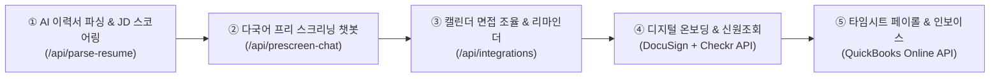

# IN2U HR 핵심 업무 프로세스 및 5대 자동화(RPA/AI) 상세 명세서

## 1. IN2U HR의 핵심 업무 프로세스 구조

스태핑/리크루팅 에이전시의 특성상 클라이언트(구인 기업)와 구직자(후보자) 사이에서 다음 5단계 다단계 프로세스로 운영됩니다.

| 프로세스 단계 | 주요 업무 내용 | 현재의 일반적 수작업 병목 |
| :--- | :--- | :--- |
| **1. 채용 의뢰 접수 & 소싱** | • 클라이언트 JD 접수 및 타겟 프로필 설정 • Job Board(링크드인, 인디드, 자체 잡보드 등) 공고 게시 및 지원자 접수 | • 다중 채널 공고 등록 및 지원서 취합 수작업 • 이력서 포맷 상이 |
| **2. 스크리닝 & 1차 검증** | • 비자 상태(미국 영주권/취업비자 등), 어학 능력(한국어/영어/스페인어), 경력 요건 확인 • 1차 전화/화상 프리 스크리닝 인터뷰 진행 | • 지원 자격 미달자 필터링에 많은 리크루터 공수 소요 • 다국어 구사 여부 개별 검증 |
| **3. 면접 조율 & 고객사 추천** | • 검증된 후보자 추천서(Candidate Profile/Resume) 재가공 및 송부 • 고객사 면접 일정 조율, 리마인더 발송 및 피드백 수렴 | • 고객사-후보자 간 일정 조율 메일 핑퐁 • 추천서 양식 통일 작업 |
| **4. 채용 결정 & 온보딩** | • 오퍼레터 발급 및 계약 체결 • I-9(취업 자격 확인), W-4, 배경조회(Background Check) 서류 접수 | • 계약서 서명 추적 및 신원조회 수기 확인 • 온보딩 서류 누락 체크 |
| **5. 파견 관리 & 페이롤 (Staffing)** | • 파견/임시직 근무자의 근무시간(Time-sheet) 집계 • 주/월 단위 급여 계산, 세금 공제, 고객사 인보이스 발행 | • 현장 타임시트 승인 누락, 지각/초과근무 검증 • 인보이스 대사 및 미수금 관리 |

---

## 2. 프로세스 자동화(RPA / AI) 5대 모듈 아키텍처

### ① AI 기반 이력서 파싱 및 적합도 스코어링 (소싱 & 스크리닝 자동화)
- **아이디어**: 지원자가 제출한 영문/국문 이력서를 AI가 분석하여 (1) 비자 상태, (2) 다국어 구사 수준(한국어·영어·스페인어), (3) 핵심 기술/경력을 자동 추출합니다.
- **효과**: 채용 공고(JD)의 필수 요건과 대조해 적합도 점수(0~100점)를 매겨, 리크루터가 상위 적합자에게 즉각 연락할 수 있도록 우선순위를 자동 정렬하고 표준 추천서 양식으로 자동 변환합니다.

### ② 다국어 프리 스크리닝 챗봇/음성 AI 도입
- **아이디어**: 웹사이트 지원 직후 또는 링크드인 지원자에게 카카오톡/문자(SMS)/웹챗 링크를 발송하여 기본 자격(희망 연봉, 출근 가능일, 근무 가능 지역, 비자 지원 필요 여부)을 2~3분 인터뷰 형태로 자동 수집합니다.
- **효과**: 단순 정보 확인 목적의 1차 전화 스크리닝 시간을 70% 이상 단축하고, 한국어·영어·스페인어 24시간 즉시 응대가 가능해집니다.

### ③ 캘린더 연동 면접 스케줄링 및 리마인더 자동화
- **아이디어**: Calendly 또는 ATS 스케줄러를 연동하여, 고객사 인터뷰어가 가능한 시간 슬롯을 후보자에게 전송하고 후보자가 선택하면 Zoom/Teams 링크 및 캘린더 초대가 자동 생성되도록 구성합니다.
- **효과**: 면접 전날(D-1) 및 2시간 전(H-2) 후보자에게 SMS/이메일 리마인더와 길 안내/면접 팁을 자동 발송하여 인터뷰 노쇼(No-show)율을 대폭 낮춥니다.

### ④ 디지털 온보딩 & 규정 준수(Compliance) 자동화
- **아이디어**: 합격 통보 시 전자서명 툴(DocuSign, PandaDoc 등)을 통해 온보딩 패키지(I-9, W-4, Direct Deposit, NDA 등)가 자동 발송되도록 파이프라인을 구축합니다.
- **효과**: 서류 서명 완료 여부를 실시간 추적하고 미작성자에게 자동 리마인드를 보내며, 백그라운드 체크 API(Checkr 등)와 연동해 결과 확인 시 담당자에게 즉시 알림을 전달합니다.

### ⑤ 타임시트 연동 페이롤 및 인보이스 자동 발행 (Staffing 핵심)
- **아이디어**: 현장 근무자의 모바일/웹 출퇴근 기록을 클라이언트 담당자가 원클릭 승인하면, 급여 계산 시스템(미국 FLSA 초과근무 1.5배 할증 자동 반영)과 회계 툴(QuickBooks, Xero 등)로 데이터가 자동 전송되어 고객사 청구 인보이스를 자동 생성·발송합니다.
- **효과**: 엑셀로 일일이 타임시트를 합산하고 인보이스를 수작업 타이핑하는 과정을 없애 오지급 및 청구 누락 오류를 원천 차단합니다.
